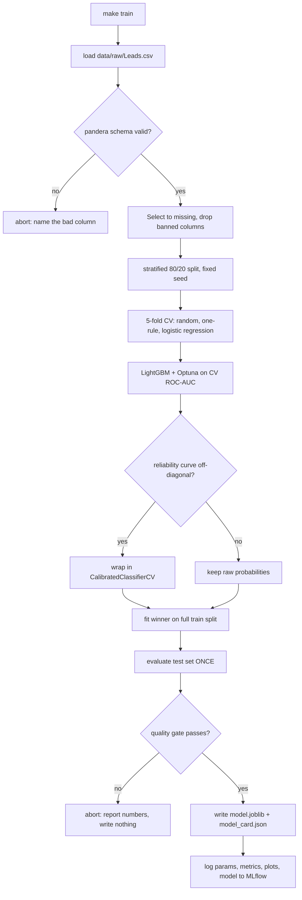
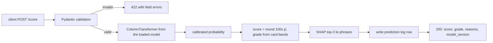
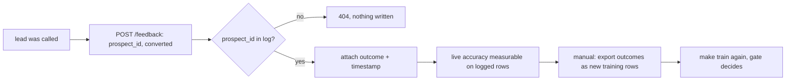

# 04 — Flows

Two kinds of flow: **pipeline flows** (what the system does, no human watching) and **surface flows** (the three dashboard journeys). Exceptional paths are listed with each.

## Pipeline flow 1 — Train a model

**Exceptions:** CSV absent → message with the Kaggle download steps, exit 1. Schema invalid → the failing column and expectation, exit 1. Gate failed → both models' numbers side by side, exit 1, previous model untouched.

## Pipeline flow 2 — Score a lead (request path)

Unknown category → mapped to `Other`, scored normally, no error. Model file missing at startup → the app refuses to start rather than serving a fake score. Log write fails → the score is still returned; the failure is logged at `ERROR` (scoring must not depend on the log).

## Pipeline flow 3 — Outcome feedback and retraining

Retraining is never automatic in P1. The loop exists so the capstone can close it.

## Surface flow 1 — Rank leads (the main journey)

1. Rep opens the dashboard, lands on **Rank leads**.
2. Empty state explains what to upload and offers a sample CSV.
3. Rep uploads a CSV.
4. Client-side check: required columns present, row count ≤ batch limit. Missing column → inline error naming it, nothing sent.
5. Spinner while `POST /score/batch` runs.
6. Table renders, sorted by score descending: `score`, grade chip (A/B/C), `prospect_id`, the three reasons, then the input columns.
7. Rep filters to grade A, scans the reasons, downloads the ranked CSV.

**Exceptions:** over the batch limit → offer to score the first 1,000 and say so. API unreachable → "scoring service is not responding", keep the uploaded file in session so nothing is lost. All rows fail validation → show the first three field errors, not a traceback. Empty file → the empty state, unchanged.

## Surface flow 2 — Try one lead

1. Rep opens **Try one lead**; form fields are exactly the admissible features, each labelled in business language with its unit.
2. Defaults are the dataset medians/modes so the form is never blank.
3. Submit → `POST /score` → score, grade and the three reasons, with the probability shown as a percentage.
4. Changing one field and resubmitting shows how the score moves — the cheapest way to build trust in the model.

**Exceptions:** negative number → field-level 422 message, form state kept. Service down → same message as flow 1.

## Surface flow 3 — Model card

Read-only. Shows: model version and training date; the results table (all five rows from doc 02); the reliability curve; score distribution by outcome; feature importance; the grade bands with their cut-offs; and a plain **"What this model must not be used for"** section — no automated discard of leads, no use on a population unlike X Education's web leads, no inference about individuals beyond ranking.

All figures come from `/model-info` and the model card file. The page never recomputes a metric.

## Navigation

Three pages in a left sidebar, in the order above. **Rank leads** is the default. No nested navigation, no modal dialogs, no login. The model version is visible on every page, in the footer, so a screenshot is always attributable to a model.
