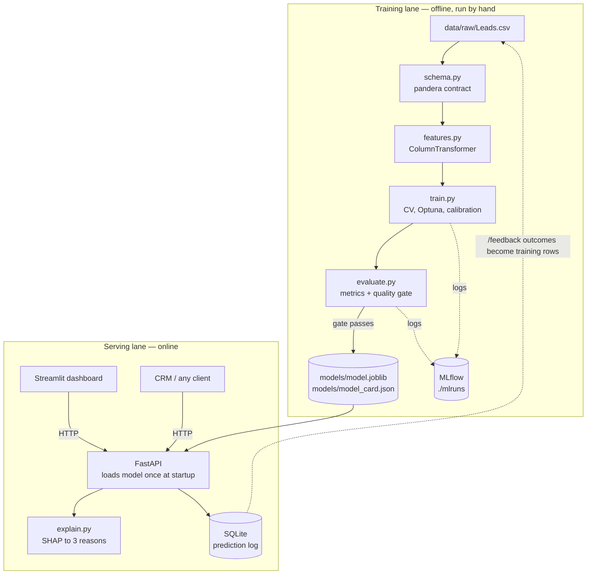

# 05 — Technical Architecture

## Shape of the system

Two halves joined by one file. **Training** produces a versioned model; **serving** only loads it. That split means the model can be retrained without touching the API, and a bad model is rolled back by swapping one file.



The dotted line from the prediction log back to the data is the **retraining loop**. In P1 it is manual: outcomes accumulate, a human exports them and runs `make train` again.

## Stack

Every choice is justified against this project, not against popularity. Alternatives and their trade-offs are in doc 14.

| Layer | Choice | Why this one for P1 | Limitation accepted |
| --- | --- | --- | --- |
| Language | **Python 3.11** | the whole tabular-ML stack lives here; 3.11 is what is installed on this machine | 3.12 was the plan; see doc 13 OQ-4 |
| Dependency manager | **uv** (fallback: `pip` + `venv`) | fast installs and a lockfile, so CI and laptop match | not installed yet; needs approval, doc 13 OQ-2 |
| Data validation | **pandera** | declarative column contract that fails loudly; the alternative is scattered `assert`s | adds a dependency to catch a class of bug that would otherwise be silent |
| Dataframes | **pandas** | the dataset is 9,240 rows — nothing bigger is warranted | would not scale to millions of rows; irrelevant here |
| Baselines + pipeline | **scikit-learn** | `Pipeline` guarantees identical preprocessing in training and serving | — |
| Challenger model | **LightGBM** | strong on small tabular data, handles categories and missing values, trains in seconds on 9k rows | a tree ensemble cannot extrapolate; fine for ranking |
| Tuning | **Optuna** | fixed trial budget, easy to cut if time runs short | first thing cut under time pressure |
| Calibration | **sklearn `CalibratedClassifierCV`** | the score must mean a probability, or grades are meaningless | costs a CV fit |
| Explanations | **SHAP `TreeExplainer`** | exact and fast for tree models; per-lead reasons are a stated requirement | adds latency per request; budgeted at < 100 ms |
| Experiment tracking | **MLflow**, local SQLite (`sqlite:///mlflow.db`) | compares runs without a server or an account | local only; the plain file store was retired in MLflow 3.18, so a DB backend is the supported local path |
| API | **FastAPI + Pydantic v2 + Uvicorn** | typed request validation and a free `/docs` page, which is half the demo | — |
| Prediction log | **SQLite** | zero setup, one file, enough for a demo's volume | single writer; becomes Postgres in the capstone |
| Dashboard | **Streamlit** | a usable three-page UI in one file, and P1's point is the pipeline | little design control — see doc 08 and OQ-5 |
| Tests / lint | **pytest + ruff** | standard, fast, and what CI runs | — |
| Packaging | **Docker + Docker Compose** | the same image runs locally, in CI and in production | Docker not installed yet; OQ-3 |
| CI | **GitHub Actions** | free for a public repo; the quality gate needs somewhere to run | — |
| Hosting | **Hugging Face Spaces (Docker)**, alt. Render | free tier, Docker-native, public URL for the demo | cold starts; free tiers change — verify limits before relying on them |

Deliberately **not** used: no LLM (no token cost, no latency, nothing to hallucinate in a score), no cloud ML platform (overkill for 9k rows), no feature store, no Kubernetes, no message queue (the capstone adds one when webhooks arrive), no ORM (two tables, raw SQL is clearer), no frontend framework (React arrives in P3).

## Repository layout — what lives where

```
lead-scoring-pipeline/
├── README.md                    problem, results table, demo link, quickstart
├── CLAUDE.md                    permanent working rules for AI sessions
├── pyproject.toml               deps + ruff + pytest config          [Phase 1]
├── Makefile                     train | serve | test | lint | docker [Phase 1]
├── docker-compose.yml           api + dashboard                      [Phase 6]
├── Dockerfile                   one image, two entrypoints           [Phase 6]
├── .env.example                 every setting, no real values
├── .gitignore                   data, models, db, secrets excluded
├── .github/workflows/ci.yml     lint, test, build, gate              [Phase 6]
├── data/
│   └── raw/                     Leads.csv goes here — git-ignored
├── scripts/
│   ├── check_data.py            verifies the downloaded dataset      [Phase 1]
│   ├── eda.py                   writes reports/01_eda.md             [Phase 2]
│   └── leakage_audit.py         writes reports/02_leakage_audit.md   [Phase 2]
├── reports/                     generated analysis, committed        [Phase 2]
│   ├── 01_eda.md
│   ├── 02_leakage_audit.md
│   └── figures/*.png
├── scripts/
│   ├── check_data.py            stdlib-only dataset verifier          [Phase 1]
│   ├── doctor.py                environment preflight, ~2 seconds     [Phase 1]
│   ├── eda.py                   report 01                             [Phase 2]
│   └── leakage_audit.py         report 02                             [Phase 2]
├── requirements.lock            the pinned resolution that works
├── src/leadscore/
│   ├── config.py                feature lists, paths, seed, thresholds [Phase 1]
│   ├── schema.py                pandera contract on the raw CSV       [Phase 2]
│   ├── features.py              cleaning + ColumnTransformer          [Phase 3]
│   ├── train.py                 CV, tuning, calibration, MLflow       [Phase 3]
│   ├── plotting.py              shared chart tokens + axis guard      [Phase 2]
│   ├── fixtures.py              synthetic Leads.csv for CI and tests  [Phase 3]
│   ├── evaluate.py              metrics, plots, quality gate          [Phase 4]
│   ├── explain.py               SHAP values to plain-English reasons   [Phase 4]
│   └── api/
│       ├── main.py              FastAPI app, lifespan model load      [Phase 5]
│       ├── schemas.py           Pydantic request/response models      [Phase 5]
│       └── store.py             SQLite prediction log                 [Phase 5]
├── dashboard/app.py             Streamlit, calls the API              [Phase 6]
├── models/                      model.joblib + model_card.json — git-ignored
├── tests/
│   ├── test_config.py                                                 [Phase 1]
│   ├── test_schema.py                                                 [Phase 2]
│   ├── test_features.py                                               [Phase 3]
│   ├── test_train.py                                                  [Phase 3]
│   ├── test_fixtures.py         the fixture still matches the contract [Phase 3]
│   ├── test_plotting.py         the honest-axis rule                   [Phase 3]
│   ├── test_smoke.py            the whole chain, synthetic data        [Phase 3]
│   ├── test_api.py                                                    [Phase 5]
│   └── test_model_quality.py                                          [Phase 4]
├── docs/                        01–14, this documentation set
└── design-system/lead-scoring-pipeline/
    ├── MASTER.md                generated design tokens and rules
    └── pages/                   per-page overrides
```

Phase numbers refer to doc 11.

## Module boundaries

Four rules keep the layers from leaking into each other:

1. **`src/` never imports from `notebooks/`.** Notebooks explore; they are not a dependency. Code that proves useful in a notebook is moved into `src/`, not imported from it.
2. **The API never preprocesses.** All cleaning and encoding live in the fitted `ColumnTransformer` inside `model.joblib`. If the API touches a raw column by hand, training and serving will drift apart.
3. **The dashboard never imports the model.** It only speaks HTTP to the API, exactly as a CRM would. This is why it is a credible demo and not a notebook with a skin.
4. **Nothing reads a threshold from code.** Grade bands, gate floors and the feature list come from config or the model card, so a business change is a config change.

## Data flow, end to end

**Training:** CSV → pandera validation → `"Select"` → missing → banned columns dropped → one stratified split → CV on the training part only → fitted transformer + model → calibration → single test-set evaluation → gate → `model.joblib` + `model_card.json` + MLflow run.

**Serving:** JSON → Pydantic → DataFrame of one row (or N rows) → the model's own transformer → calibrated probability → score and grade → SHAP top-3 → phrase map → response → prediction-log row.

**Feedback:** outcome JSON → match on `prospect_id` → update the log row → available for live accuracy and as a future training row.

## State management

The pipeline is stateless except for three artifacts, each with one owner:

| State | Where | Owner | Lifetime |
| --- | --- | --- | --- |
| Model + card | `models/` (baked into the image at build) | training lane | until the next passing gate |
| Prediction log | SQLite file / mounted volume | API | kept; retention is OQ-7 |
| Experiment history | `./mlruns` | training lane | local, not deployed |

The API holds the model and the SHAP explainer in memory, loaded once in the FastAPI lifespan hook. No request-scoped global state, so a worker can be restarted or scaled without coordination.

## Error handling, logging, validation

- **Validation at every boundary:** pandera on the raw data, Pydantic on every request, an explicit check that `model.joblib` exists and its version matches the card before the app accepts traffic.
- **Fail fast where correctness is at stake** (bad data, missing model, failed gate) and **degrade where it is not** (a failed log write still returns the score).
- **Errors to clients are JSON**, with a stable shape: `detail`, `code`, and the offending field where applicable. No HTML tracebacks, no stack traces to clients.
- **Logging:** structured, one line per request at `INFO` with the model version and latency; `ERROR` with a stack trace for unexpected failures, recorded server-side only. Training logs each stage with its duration and metrics. Nothing logs a secret.

## Scalability, honestly

P1 does not need to scale, and pretending otherwise would be over-engineering. What it does need is to not *block* scaling later: the API is stateless so it scales horizontally behind any load balancer; the model is an immutable artifact so instances cannot disagree; SQLite is isolated behind `store.py` so the capstone swaps in Postgres by changing one module; batch scoring is capped so one client cannot exhaust memory. The known ceilings are a single SQLite writer, in-process SHAP cost per request, and free-tier cold starts.
