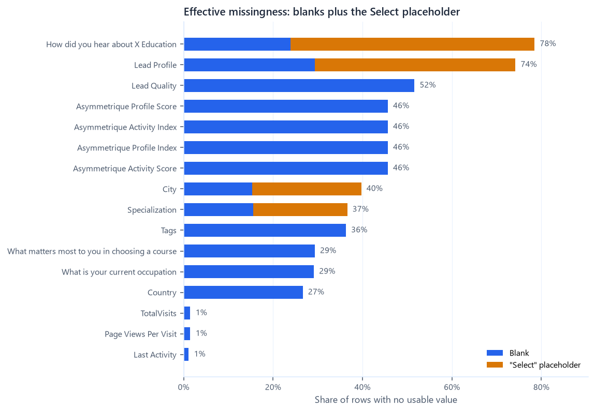
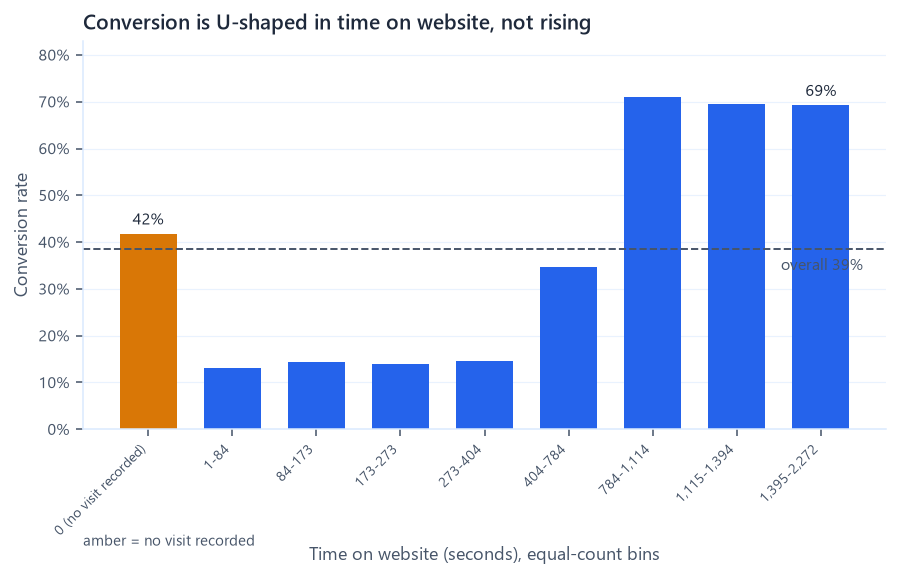
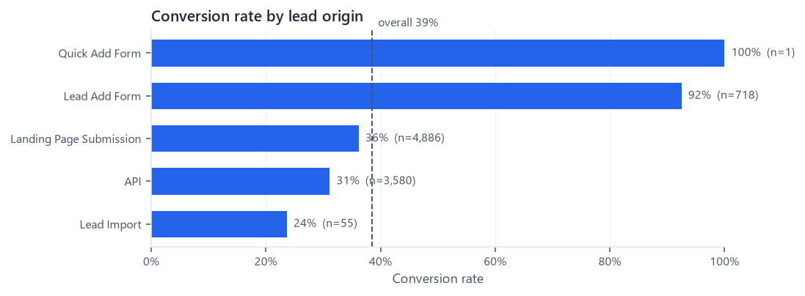
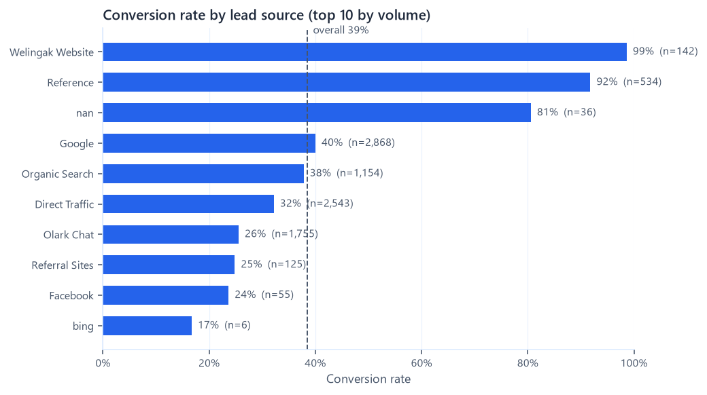

# 01 — Exploratory data analysis

Task T-201 · generated by `scripts/eda.py` · 9,240 leads by 37 columns

**3,561 of 9,240 leads converted (38.5%).** Everything below is measured from `data/raw/Leads.csv`; nothing is carried over from the planning docs.

## What this changes

1. **12 columns are near-constant** (one value covers ≥ 95% of rows) and carry no signal. They are the ad and opt-in flags docs/02 said to 'check first'. Drop them.

2. **7 columns are ≥ 40% empty** once `Select` counts as missing. Two of them are admissible features, so they need a decision rather than a default.

3. **Time on website predicts conversion, but U-shaped rather than rising.** Leads with no recorded visit convert above average, so the one-rule baseline that sorts by time on site ranks them last and is weaker than it appears.

4. **`Lead Origin = Lead Add Form` converts at 92.5% across 718 leads — a red flag for T-203.** A category that almost always converts usually means the row was created *because* something already happened, not that the origin causes conversion. `Lead Origin` is otherwise admissible, so the audit has to decide whether this one level is a record-keeping artefact. Do not keep it just because it is predictive; that is the trap this project exists to avoid.

## Missingness

`Select` is a form default, not an answer. A column can look populated and be empty in practice, so both bases are reported.

| Column | Blank | `Select` | Effectively missing | Unique | Near-constant |
| --- | ---: | ---: | ---: | ---: | :---: |
| `How did you hear about X Education` | 23.9% | 54.6% | **78.5%** | 10 |  |
| `Lead Profile` | 29.3% | 44.9% | **74.2%** | 6 |  |
| `Lead Quality` | 51.6% | 0.0% | **51.6%** | 5 |  |
| `Asymmetrique Profile Index` | 45.6% | 0.0% | **45.6%** | 3 |  |
| `Asymmetrique Activity Index` | 45.6% | 0.0% | **45.6%** | 3 |  |
| `Asymmetrique Activity Score` | 45.6% | 0.0% | **45.6%** | 12 |  |
| `Asymmetrique Profile Score` | 45.6% | 0.0% | **45.6%** | 10 |  |
| `City` | 15.4% | 24.3% | **39.7%** | 7 |  |
| `Specialization` | 15.6% | 21.0% | **36.6%** | 19 |  |
| `Tags` | 36.3% | 0.0% | **36.3%** | 26 |  |
| `What matters most to you in choosing a course` | 29.3% | 0.0% | **29.3%** | 3 |  |
| `What is your current occupation` | 29.1% | 0.0% | **29.1%** | 6 |  |
| `Country` | 26.6% | 0.0% | **26.6%** | 38 |  |
| `Page Views Per Visit` | 1.5% | 0.0% | **1.5%** | 114 |  |
| `TotalVisits` | 1.5% | 0.0% | **1.5%** | 41 |  |
| `Last Activity` | 1.1% | 0.0% | **1.1%** | 17 |  |
| `Lead Source` | 0.4% | 0.0% | **0.4%** | 21 |  |

## Near-constant columns

One value covers ≥ 95% of rows, so the column cannot discriminate. Dropping these costs nothing and shortens the feature list.

| Column | Dominant value | Share | Unique |
| --- | --- | ---: | ---: |
| `Newspaper` | No | 100.0% | 2 |
| `X Education Forums` | No | 100.0% | 2 |
| `Newspaper Article` | No | 100.0% | 2 |
| `Magazine` | No | 100.0% | 1 |
| `Search` | No | 99.8% | 2 |
| `Do Not Call` | No | 100.0% | 2 |
| `Get updates on DM Content` | No | 100.0% | 1 |
| `Update me on Supply Chain Content` | No | 100.0% | 1 |
| `Through Recommendations` | No | 99.9% | 2 |
| `Receive More Updates About Our Courses` | No | 100.0% | 1 |
| `Digital Advertisement` | No | 100.0% | 2 |
| `I agree to pay the amount through cheque` | No | 100.0% | 1 |

## Numeric features

| Feature | Missing | Min | Median | Mean | p95 | Max |
| --- | ---: | ---: | ---: | ---: | ---: | ---: |
| `TotalVisits` | 1.5% | 0 | 3 | 3.4 | 10 | 251 |
| `Total Time Spent on Website` | 0.0% | 0 | 248 | 487.7 | 1,562 | 2,272 |
| `Page Views Per Visit` | 1.5% | 0 | 2 | 2.4 | 6 | 55 |

**The relationship is U-shaped, not rising.** Leads with no recorded visit convert at 41.8% (2,193 leads), above the 38.5% average. Among leads that did browse, conversion bottoms out at 13.2% in the 1-84 second band and climbs to 70.9% in the 784-1,114 band.

This matters for the baseline. Ranking leads by time on site, which is the one-rule baseline and what a sales manager would do by hand, puts the zero-time group **last** even though it converts above average. That group is a different population rather than a cold one: most likely imported or offline leads whose browsing was never tracked.

1. The one-rule baseline is weaker than its headline suggests, so beating it is a lower bar than it looks. The README should say so rather than claim an easy win.
2. A linear model cannot fit a U-shape in a raw numeric feature, so logistic regression needs time on site binned or paired with a zero indicator. LightGBM handles it natively, and that may turn out to be most of the gap between the two (T-304).

| Time on site (seconds) | Leads | Converted | Rate |
| --- | ---: | ---: | ---: |
| 0 (no visit recorded) | 2,193 | 916 | 41.8% |
| 1-84 | 881 | 116 | 13.2% |
| 84-173 | 881 | 127 | 14.4% |
| 173-273 | 881 | 122 | 13.8% |
| 273-404 | 881 | 128 | 14.5% |
| 404-784 | 880 | 305 | 34.7% |
| 784-1,114 | 881 | 625 | 70.9% |
| 1,115-1,394 | 881 | 612 | 69.5% |
| 1,395-2,272 | 881 | 610 | 69.2% |

23.7% of leads spent **zero** seconds on the website. They are not an error — a lead can arrive through an import or a cold list — but they make the single strongest feature uninformative for that slice, which the error analysis (T-406) should revisit.

## Conversion by where the lead came from

| Lead Origin | Leads | Converted | Rate |
| --- | ---: | ---: | ---: |
| Landing Page Submission | 4,886 | 1,768 | 36.2% |
| API | 3,580 | 1,115 | 31.1% |
| Lead Add Form | 718 | 664 | 92.5% |
| Lead Import | 55 | 13 | 23.6% |
| Quick Add Form | 1 | 1 | 100.0% |

Top 10 sources by volume.

| Lead Source | Leads | Converted | Rate |
| --- | ---: | ---: | ---: |
| Google | 2,868 | 1,147 | 40.0% |
| Direct Traffic | 2,543 | 818 | 32.2% |
| Olark Chat | 1,755 | 448 | 25.5% |
| Organic Search | 1,154 | 436 | 37.8% |
| Reference | 534 | 490 | 91.8% |
| Welingak Website | 142 | 140 | 98.6% |
| Referral Sites | 125 | 31 | 24.8% |
| Facebook | 55 | 13 | 23.6% |
| nan | 36 | 29 | 80.6% |
| bing | 6 | 1 | 16.7% |

## What T-202 and T-203 take from this

- The pandera schema (T-202) enforces the dtypes and ranges in the numeric table above, and rejects the near-constant columns before they reach a model.
- The leakage audit (T-203) still has to classify every column; this report settles only the *usefulness* question, never the *admissibility* one. A column can be perfectly predictive and still be banned.
