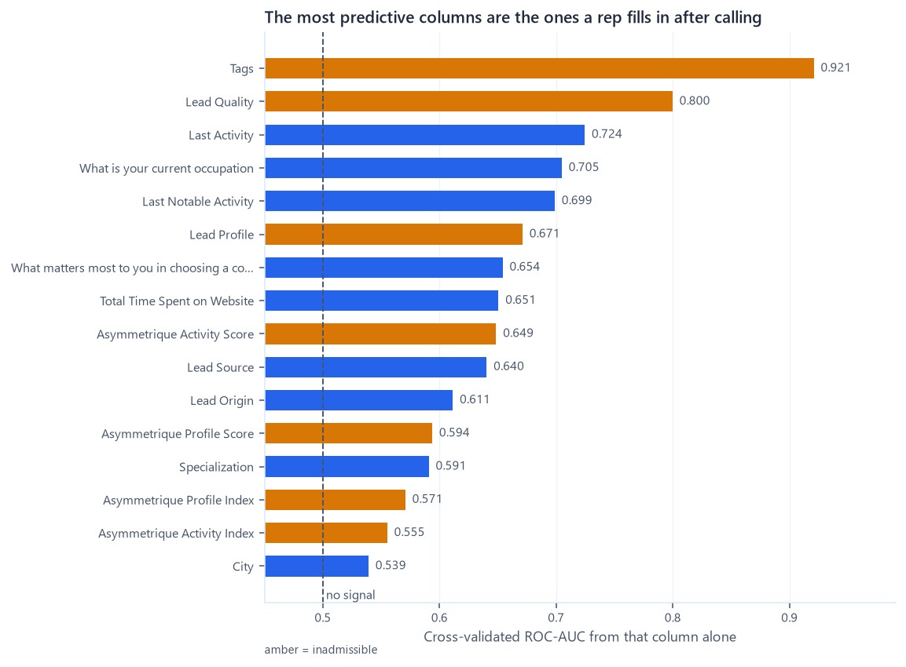

# 02 — Leakage audit

Tasks T-203 and T-204 · generated by `scripts/leakage_audit.py` · 9,240 leads

**Using the columns a sales rep fills in after calling a lead lifts cross-validated ROC-AUC from 0.865 to 0.982.** That gap is not a better model. It is the model being told the answer. Every number in this project's results table comes from the 0.865 column set.

## What the banned columns are worth

Same logistic regression, same 5-fold stratified split, same seed. Only the feature set changes.

| Feature set | Columns | CV ROC-AUC | Verdict |
| --- | ---: | ---: | --- |
| Shipping (admissible only) | 13 | 0.865 | **the set this project ships** |
| + activity columns | 15 | 0.897 | not shippable — values a fresh lead cannot have |
| + sales-filled (leaks) | 21 | 0.982 | not shippable — written after the rep calls |

Adding the two activity columns moves ROC-AUC from 0.865 to 0.897. Adding the six sales-filled columns moves it to 0.982. A public notebook reporting a number near 0.98 on this dataset is almost certainly scoring leads with information that does not exist when a lead arrives.

## Which columns carry the signal

One logistic regression per column, cross-validated, nothing else in the model. 0.500 means the column tells you nothing.

| Column | AUC alone | Admissible |
| --- | ---: | --- |
| `Tags` | 0.921 | No - leakage |
| `Lead Quality` | 0.800 | No - leakage |
| `Last Activity` | 0.724 | Tested both ways |
| `What is your current occupation` | 0.705 | Yes |
| `Last Notable Activity` | 0.699 | Tested both ways |
| `Lead Profile` | 0.671 | No |
| `What matters most to you in choosing a course` | 0.654 | Yes |
| `Total Time Spent on Website` | 0.651 | Yes |
| `Asymmetrique Activity Score` | 0.649 | No - leakage |
| `Lead Source` | 0.640 | Yes |
| `Lead Origin` | 0.611 | Yes |
| `Asymmetrique Profile Score` | 0.594 | No - leakage |
| `Specialization` | 0.591 | Yes |
| `Asymmetrique Profile Index` | 0.571 | No - leakage |
| `Asymmetrique Activity Index` | 0.555 | No - leakage |
| `City` | 0.539 | Yes |
| `Do Not Email` | 0.538 | Yes |
| `Country` | 0.533 | Yes |
| `TotalVisits` | 0.522 | Yes |
| `A free copy of Mastering The Interview` | 0.519 | No |

## The activity columns: contaminated, not clean

docs/02 said to test `Last Activity` and `Last Notable Activity` both ways rather than assume. Here is why they cannot simply be kept: their values mix things the **lead** did with things the **company** did.

**`Last Activity`**

| Value | Leads | Conversion | Who did it |
| --- | ---: | ---: | --- |
| Email Opened | 3,437 | 36.5% | the lead |
| SMS Sent | 2,745 | 62.9% | **the company** |
| Olark Chat Conversation | 973 | 8.6% | the lead |
| Page Visited on Website | 640 | 23.6% | the lead |
| Converted to Lead | 428 | 12.6% | the lead |
| Email Bounced | 326 | 8.0% | **the company** |
| Email Link Clicked | 267 | 27.3% | the lead |
| Form Submitted on Website | 116 | 24.1% | the lead |

**`Last Notable Activity`**

| Value | Leads | Conversion | Who did it |
| --- | ---: | ---: | --- |
| Modified | 3,407 | 23.0% | **the company** |
| Email Opened | 2,827 | 36.9% | the lead |
| SMS Sent | 2,172 | 69.4% | **the company** |
| Page Visited on Website | 318 | 29.2% | the lead |
| Olark Chat Conversation | 183 | 13.7% | the lead |
| Email Link Clicked | 173 | 26.0% | the lead |
| Email Bounced | 60 | 15.0% | **the company** |
| Unsubscribed | 47 | 29.8% | the lead |

`SMS Sent` is an outbound message. `Unreachable` is the outcome of a call attempt. Both convert far above average, and **neither can exist for a lead that has just arrived** — which is the definition of a feature that is not known at scoring time. Keeping these columns trains the model on a world that does not exist when it is asked to predict.

That is the whole gap between the first two rows of the table above: +0.032 ROC-AUC bought with contaminated values. **Decided 2026-11-17: both columns are excluded from the shipping model** and reported as a labelled comparison, exactly as the sales-filled row is. See D-016.

## The decision record — every column

A column is admissible only if its value is known at the moment the lead is scored. This table is the record docs/02 FR-2 requires; no column is left unclassified.

| Column | Group | Admissible | Why |
| --- | --- | --- | --- |
| `Converted` | Target | target | this is the label |
| `City` | Form answer | Yes | self-reported by the lead on the form at submission |
| `Country` | Form answer | Yes | self-reported by the lead on the form at submission |
| `Do Not Call` | Contact preference | Yes | stated by the lead on the form |
| `Do Not Email` | Contact preference | Yes | stated by the lead on the form |
| `How did you hear about X Education` | Form answer | Yes | self-reported by the lead on the form at submission |
| `Lead Origin` | Source | Yes | known the moment the lead arrives |
| `Lead Source` | Source | Yes | known the moment the lead arrives |
| `Page Views Per Visit` | Behaviour | Yes | pre-contact website behaviour, recorded before any rep acts |
| `Specialization` | Form answer | Yes | self-reported by the lead on the form at submission |
| `Total Time Spent on Website` | Behaviour | Yes | pre-contact website behaviour, recorded before any rep acts |
| `TotalVisits` | Behaviour | Yes | pre-contact website behaviour, recorded before any rep acts |
| `What is your current occupation` | Form answer | Yes | self-reported by the lead on the form at submission |
| `What matters most to you in choosing a course` | Form answer | Yes | self-reported by the lead on the form at submission |
| `Last Activity` | Activity | Tested both ways | may encode that a rep already made contact; measured below rather than assumed |
| `Last Notable Activity` | Activity | Tested both ways | may encode that a rep already made contact; measured below rather than assumed |
| `A free copy of Mastering The Interview` | Ad / opt-in flag | No | near-constant: one value covers 68.7% of rows, so it cannot discriminate |
| `Digital Advertisement` | Ad / opt-in flag | No | near-constant: one value covers 100.0% of rows, so it cannot discriminate |
| `Get updates on DM Content` | Ad / opt-in flag | No | near-constant: one value covers 100.0% of rows, so it cannot discriminate |
| `I agree to pay the amount through cheque` | Ad / opt-in flag | No | near-constant: one value covers 100.0% of rows, so it cannot discriminate |
| `Lead Number` | Identifier | No | an identifier carries no signal; `Prospect ID` is kept only to join results back |
| `Lead Profile` | Sparse | No | 74.2% empty once `Select` counts as missing; too sparse to learn from |
| `Magazine` | Ad / opt-in flag | No | near-constant: one value covers 100.0% of rows, so it cannot discriminate |
| `Newspaper` | Ad / opt-in flag | No | near-constant: one value covers 100.0% of rows, so it cannot discriminate |
| `Newspaper Article` | Ad / opt-in flag | No | near-constant: one value covers 100.0% of rows, so it cannot discriminate |
| `Prospect ID` | Identifier | No | an identifier carries no signal; `Prospect ID` is kept only to join results back |
| `Receive More Updates About Our Courses` | Ad / opt-in flag | No | near-constant: one value covers 100.0% of rows, so it cannot discriminate |
| `Search` | Ad / opt-in flag | No | near-constant: one value covers 99.8% of rows, so it cannot discriminate |
| `Through Recommendations` | Ad / opt-in flag | No | near-constant: one value covers 99.9% of rows, so it cannot discriminate |
| `Update me on Supply Chain Content` | Ad / opt-in flag | No | near-constant: one value covers 100.0% of rows, so it cannot discriminate |
| `X Education Forums` | Ad / opt-in flag | No | near-constant: one value covers 100.0% of rows, so it cannot discriminate |
| `Asymmetrique Activity Index` | Sales-filled | No - leakage | written by the sales team after working the lead, so it encodes the outcome |
| `Asymmetrique Activity Score` | Sales-filled | No - leakage | written by the sales team after working the lead, so it encodes the outcome |
| `Asymmetrique Profile Index` | Sales-filled | No - leakage | written by the sales team after working the lead, so it encodes the outcome |
| `Asymmetrique Profile Score` | Sales-filled | No - leakage | written by the sales team after working the lead, so it encodes the outcome |
| `Lead Quality` | Sales-filled | No - leakage | written by the sales team after working the lead, so it encodes the outcome |
| `Tags` | Sales-filled | No - leakage | written by the sales team after working the lead, so it encodes the outcome |

## Consequences for the build

- The shipping feature set is frozen at **13 columns** (T-205). The 12 ad and opt-in flags are out on the evidence in report 01, and the 2 activity columns on the evidence above — neither on suspicion.
- The honest baseline to beat is **0.865** ROC-AUC from logistic regression (T-303), not the leaking figure.
- The README results table carries the leaking row, labelled unshippable, so the comparison is visible rather than hidden.
- `Prospect ID` stays in the data only to join predictions back; it is never a feature.
