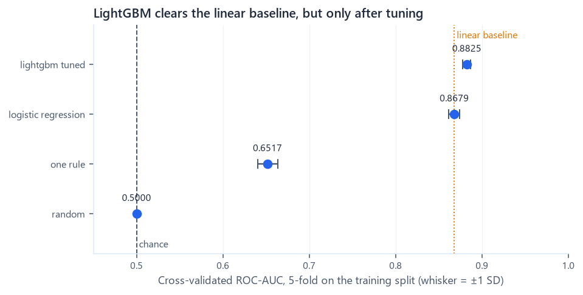

# 03 — Model selection

Tasks T-302 to T-305 · generated by `leadscore.train` · 7,392 training rows, 1,848 held back

**lightgbm tuned wins on cross-validation at 0.8825 ROC-AUC.** The test set was not opened; every number here comes from 5-fold stratified cross-validation inside the training split.



| Model | CV ROC-AUC | Std | Verdict |
| --- | ---: | ---: | --- |
| lightgbm tuned | 0.8825 | 0.0045 | **winner** |
| logistic regression | 0.8679 | 0.0062 |  |
| one rule | 0.6517 | 0.0116 |  |
| random | 0.5000 | 0.0000 |  |

## How much did the gradient booster actually buy?

The honest comparison is against logistic regression, not against chance. The margin is **+0.0145 ROC-AUC** — larger than the fold-to-fold noise, so it is a real improvement.

Both clear the one-rule baseline (0.6517) comfortably, which is the comparison a sales manager would care about: sorting a spreadsheet by time on site is genuinely worse than either model.

## Settings

| Setting | Value |
| --- | --- |
| Feature set | shipping (13 columns) |
| Split | 80% / 20%, stratified |
| Seed | 42 |
| CV | 5-fold stratified |
| Optuna trials | 40 |
| Tracking | `sqlite:///mlflow.db` |

Winning parameters:

```json
{
  "n_estimators": 500,
  "learning_rate": 0.010671997364406936,
  "num_leaves": 19,
  "min_child_samples": 18,
  "subsample": 0.6987796317254202,
  "colsample_bytree": 0.7687571139947569,
  "reg_lambda": 0.031450087048448615,
  "subsample_freq": 1
}
```
