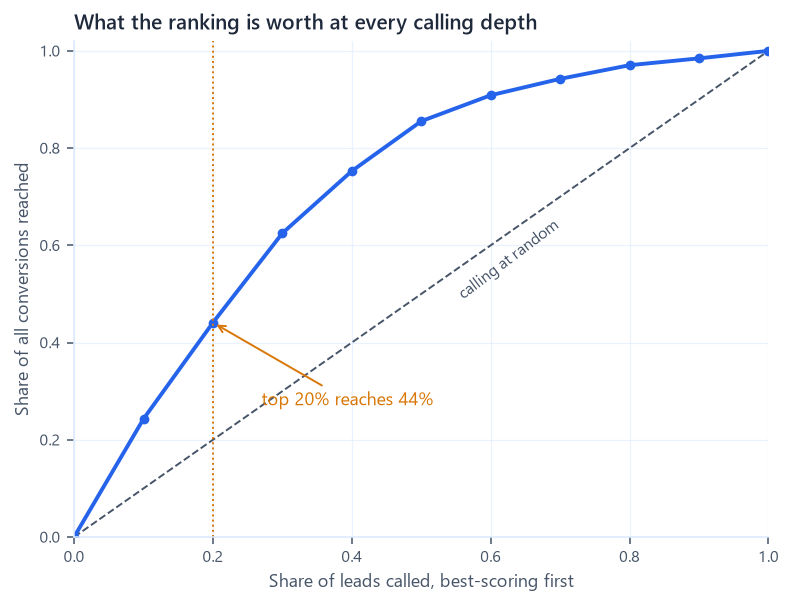
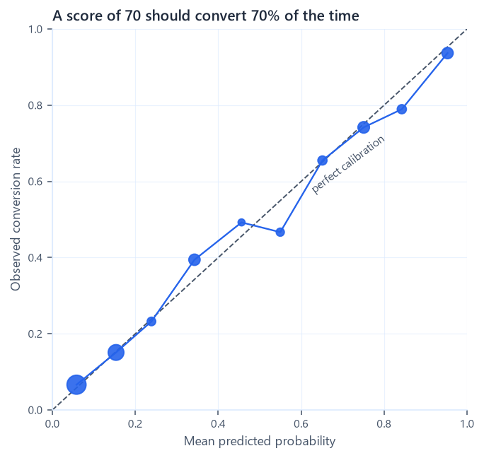
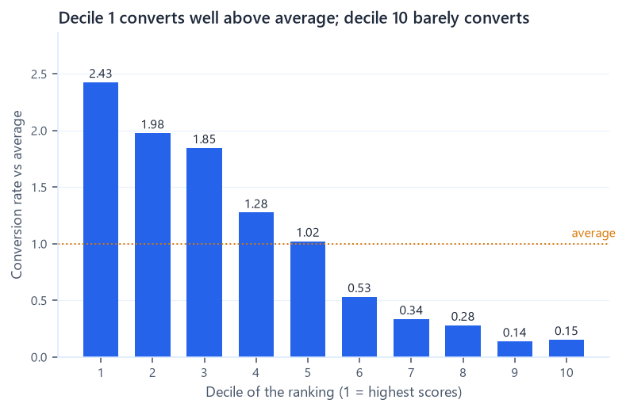

# 04 - Evaluation, calibration and the quality gate

Model version `20261121-6ae06cc8`, written by `python -m leadscore.train`.

## The headline

> Calling the top 20% of scored leads reaches **44.1%** of all conversions.

A random ranking reaches 20%. A flawless ranking would reach 52.0% at this depth, so the model closes 75% of the distance between guessing and omniscience.

## The test set was opened once

| | |
| --- | --- |
| Held-out rows | 1,848 |
| Conversions among them | 712 |
| Fingerprint of the held-out row ids | `e30abe9c3fe596c1` |
| Reads recorded in this run | 1 |

The fingerprint is a hash of the held-out row identifiers. The same value across runs means the same rows were held back, so two sets of numbers are about the same question; a different value means the seed or the upload changed. Every number below comes from that single read, and nothing in Phase 3 chose a model using any of them.

## Results

| Model | ROC-AUC | PR-AUC | Brier | Capture@20% |
| --- | ---: | ---: | ---: | ---: |
| Random baseline | 0.500 | 0.385 | 0.250 | 20.2% |
| One-rule (time on site) | 0.646 | 0.569 | 0.241 | 35.3% |
| Logistic regression | 0.850 | 0.777 | 0.152 | 42.6% |
| **LightGBM (tuned, no calibrator needed)** | 0.865 | 0.805 | 0.142 | 44.1% |
| LightGBM + sales columns *(leakage, not shippable)* | 0.984 | 0.977 | 0.043 | 51.5% |

The last row is the point of the project. Adding the columns sales fills in *after* contacting a lead lifts ROC-AUC from 0.865 to 0.984, and Capture@20% from 44.1% to 51.5%. None of it exists when a lead arrives, so none of it ships. A notebook that reports the higher number has not built a lead-scoring model; it has measured how well sales already knew.

## Calibration

| Method | Out-of-fold Brier | |
| --- | ---: | --- |
| none | 0.13119 | chosen |
| sigmoid | 0.13145 |  |
| isotonic | 0.13195 |  |

**No calibrator was applied.** Both were fitted and compared on the training split alone, and the closest (sigmoid) was 0.00027 Brier *worse* than leaving the model alone - a gap in the fourth decimal place, which is noise. The booster's own probabilities ship, and the reliability curve below is why that is defensible rather than lazy.

## Grades

| Grade | Score from | Policy |
| --- | ---: | --- |
| A | 76 | top 20% of scores |
| B | 26 | next 30% |
| C | 0 | the remaining 50% |

Cut-offs are set on out-of-fold validation scores from the training split, never on the held-out rows, and they are stored in the model card so that the API and the dashboard read the same numbers instead of hardcoding them.

## Decile lift

| Decile | Leads | Conversions | Rate | Lift | Cumulative capture |
| ---: | ---: | ---: | ---: | ---: | ---: |
| 1 | 185 | 173 | 93.5% | 2.43x | 24.3% |
| 2 | 185 | 141 | 76.2% | 1.98x | 44.1% |
| 3 | 184 | 131 | 71.2% | 1.85x | 62.5% |
| 4 | 185 | 91 | 49.2% | 1.28x | 75.3% |
| 5 | 185 | 73 | 39.5% | 1.02x | 85.5% |
| 6 | 185 | 38 | 20.5% | 0.53x | 90.9% |
| 7 | 185 | 24 | 13.0% | 0.34x | 94.2% |
| 8 | 184 | 20 | 10.9% | 0.28x | 97.1% |
| 9 | 185 | 10 | 5.4% | 0.14x | 98.5% |
| 10 | 185 | 11 | 5.9% | 0.15x | 100.0% |

## Quality gate

**PASSED** - 5 checks.

| Check | Value | Threshold | Verdict | Why it exists |
| --- | ---: | ---: | --- | --- |
| beats the linear baseline on ROC-AUC | 0.8645 | 0.8499 | pass | a gradient booster that cannot beat logistic regression has no reason to exist |
| ROC-AUC floor | 0.8645 | 0.8 | pass | below this the ranking is too weak to change who gets called |
| Brier ceiling | 0.142 | 0.18 | pass | a sharper ranking that lies about probabilities is a regression |
| Capture@20% beats random and the one-rule baseline | 0.441 | 0.3525 | pass | the headline claim is about calling the top 20%, so this is the bar that matters |
| no banned column reaches the model | 13 source columns, banned: none | 13 admissible columns, no leakage column | pass | the leakage rule is the project's whole point (CLAUDE.md rule 1) |

## Error analysis

Two groups, both read off the held-out rows: the leads the model was most confident about that never converted, and the quietest leads that converted anyway. Ten of each are shown.

### Confident and wrong (20 leads)

Scores 85 to 97. Grades: {'A': 20}.

- 13 of 20 arrived through **Lead Add Form**, which report 01 found converts far above average - the model leans on that channel hard enough to score a lead highly with no engagement at all
- 10 of 20 spent **no time on the website** at all (median 32 seconds across the group)

| Lead Origin | Lead Source | What is your current occupation | Total Time Spent on Website | TotalVisits | score | grade |
| --- | --- | --- | --- | --- | --- | --- |
| Lead Add Form | Reference | Working Professional | 1,028 | *missing* | 97 | A |
| Landing Page Submission | Google | Working Professional | 1,353 | 6 | 97 | A |
| Landing Page Submission | Direct Traffic | Working Professional | 1,736 | 2 | 96 | A |
| Landing Page Submission | Google | Working Professional | 1,218 | 3 | 96 | A |
| Lead Add Form | Reference | Working Professional | 0 | 0 | 95 | A |
| Lead Add Form | Reference | Unemployed | 1,057 | *missing* | 95 | A |
| Lead Add Form | Reference | Unemployed | 0 | 0 | 94 | A |
| Lead Add Form | Reference | Unemployed | 0 | 0 | 94 | A |
| Lead Add Form | Reference | Unemployed | 0 | 0 | 93 | A |
| Lead Add Form | Click2call | Unemployed | 0 | 0 | 93 | A |

Shared traits: `{"Lead Origin": {"Lead Add Form": 13, "Landing Page Submission": 5, "API": 2}, "Lead Source": {"Reference": 11, "Google": 4, "Direct Traffic": 2}, "What is your current occupation": {"Unemployed": 11, "Working Professional": 9}, "Total Time Spent on Website": {"median": 31.5, "min": 0.0, "max": 1736.0}, "TotalVisits": {"median": 0.0, "min": 0.0, "max": 7.0}}`

### Missed opportunities (20 leads)

Scores 3 to 7. Grades: {'C': 20}.

- 13 of 20 arrived through **API**, a channel that usually converts poorly
- 9 of 20 spent **no time on the website** at all (median 24 seconds across the group)
- 18 of 20 did not say what they do for a living

| Lead Origin | Lead Source | What is your current occupation | Total Time Spent on Website | TotalVisits | score | grade |
| --- | --- | --- | --- | --- | --- | --- |
| API | Organic Search | *missing* | 342 | 2 | 3 | C |
| Landing Page Submission | Organic Search | Unemployed | 218 | 12 | 3 | C |
| API | Olark Chat | *missing* | 0 | 0 | 4 | C |
| API | Olark Chat | *missing* | 0 | 0 | 4 | C |
| Landing Page Submission | Direct Traffic | Unemployed | 212 | 27 | 4 | C |
| Landing Page Submission | Direct Traffic | *missing* | 128 | 4 | 4 | C |
| API | Google | *missing* | 39 | 2 | 4 | C |
| Landing Page Submission | Direct Traffic | *missing* | 129 | 2 | 5 | C |
| Landing Page Submission | Organic Search | *missing* | 125 | 3 | 5 | C |
| Landing Page Submission | Direct Traffic | *missing* | 69 | 4 | 5 | C |

Shared traits: `{"Lead Origin": {"API": 13, "Landing Page Submission": 7}, "Lead Source": {"Olark Chat": 9, "Direct Traffic": 4, "Google": 4}, "What is your current occupation": {"Missing": 18, "Unemployed": 2}, "Total Time Spent on Website": {"median": 23.5, "min": 0.0, "max": 342.0}, "TotalVisits": {"median": 2.0, "min": 0.0, "max": 27.0}}`

## Limitations

- Scores one public dataset of 9,240 leads from a single education provider; nothing here transfers to another business without re-measurement.
- No column filled in after a human contacted the lead is used, so the model is weaker than published results on this dataset that use `Tags` - deliberately.
- Calibration is fitted on this one snapshot with no drift monitoring; the probabilities are trustworthy only while the lead mix resembles the training mix.
- Explanations are feature attributions, not causes. A high score is not advice about what to change.

One more number worth keeping in view: the spreadsheet sort a sales manager already does reaches 35.3% at the same depth. The model is worth 8.8 percentage points of captured conversions on top of that, which is the honest size of the win.
